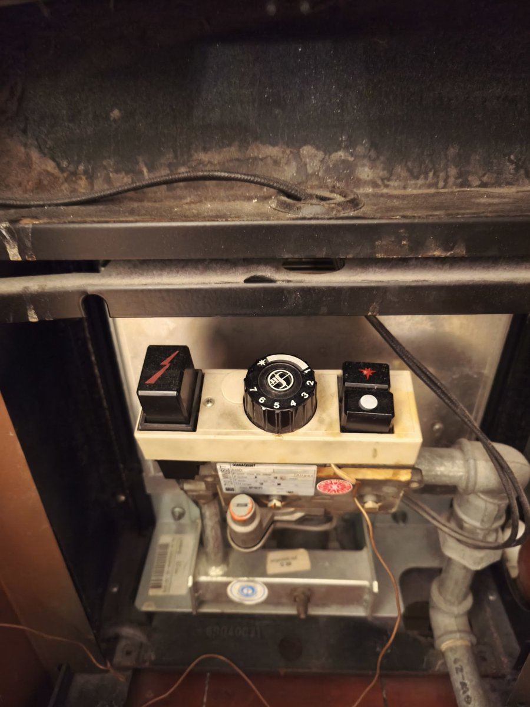
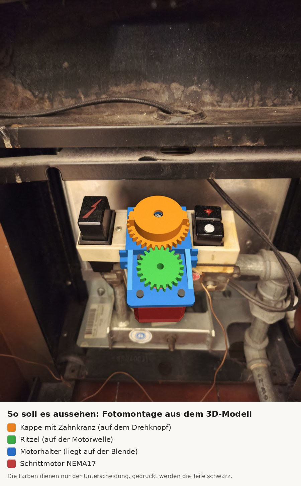
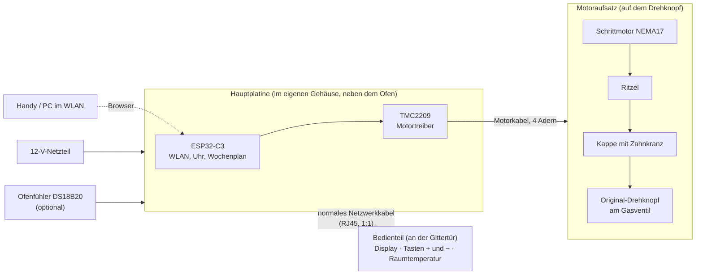
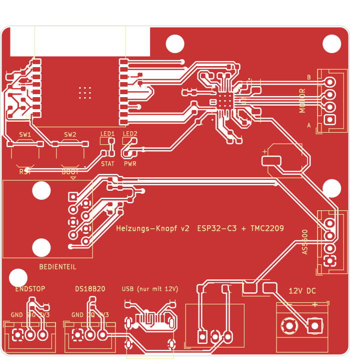
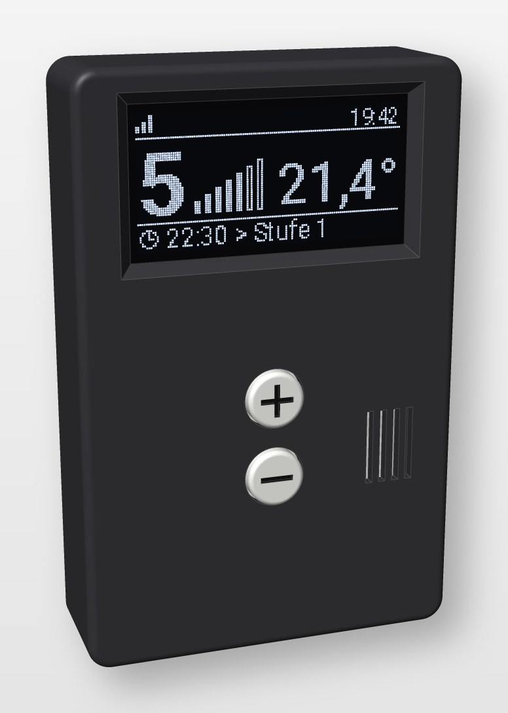
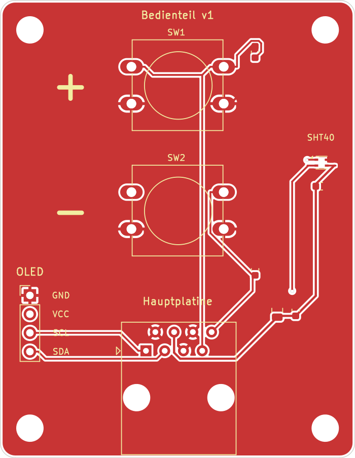
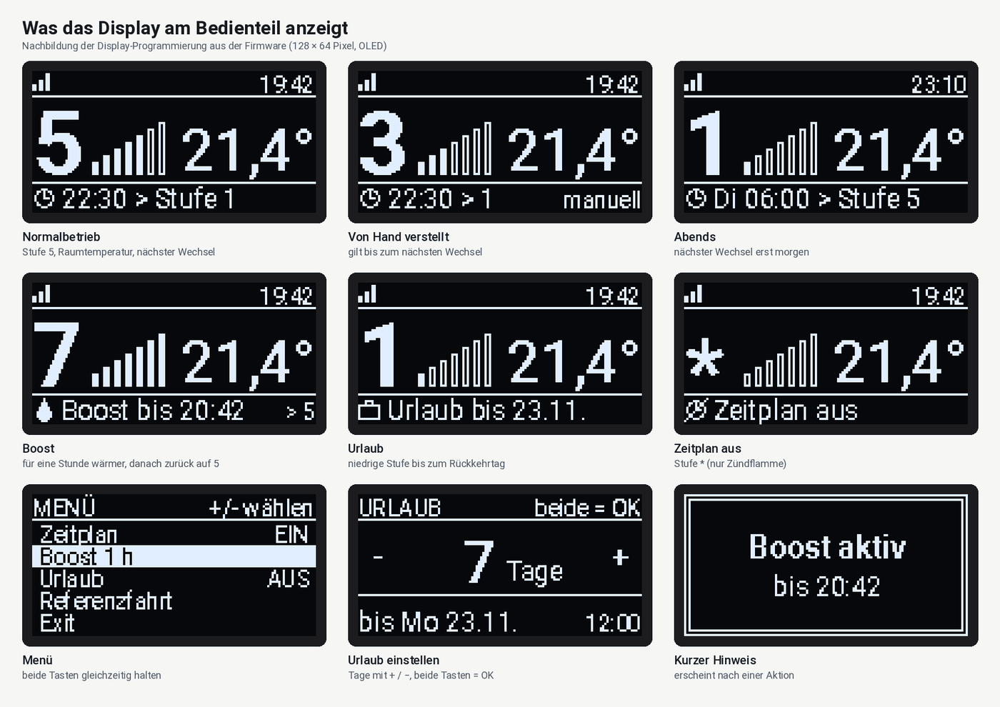
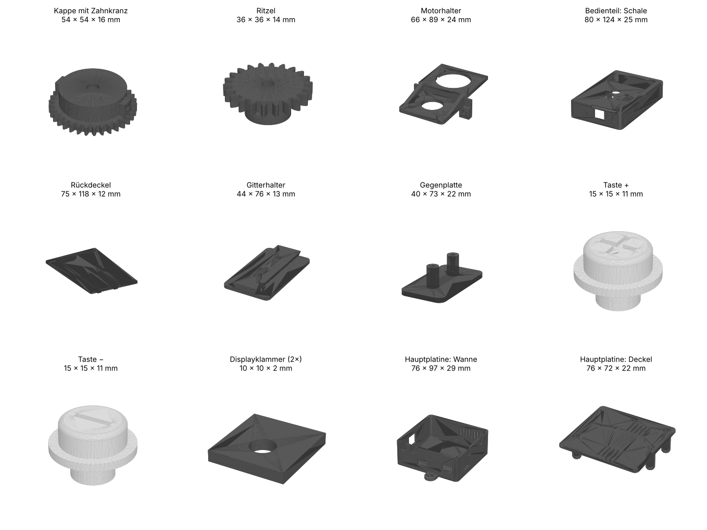
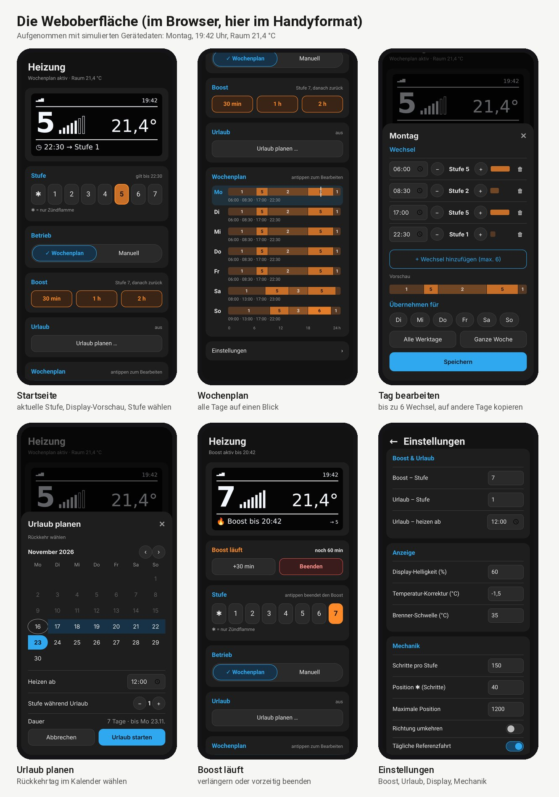

# Heizungsknopf – ein alter Gasofen bekommt einen Wochenplan

<table>
  <tr>
    <td align="center" valign="top" width="50%"></td>
    <td align="center" valign="top" width="50%"></td>
  </tr>
  <tr>
    <td align="center"><em>Heute: das Gasventil mit dem Drehknopf (✱ und 1–7)</em></td>
    <td align="center"><em>So soll es aussehen: Fotomontage mit dem Motoraufsatz (Erläuterung der Farben im Bild)</em></td>
  </tr>
</table>

Ein kleiner Motor dreht den Thermostatknopf eines Gas-Raumheizers, gesteuert von einem WLAN-Chip mit Wochenplan.
Am Ofen selbst wird nichts verändert: Der Aufsatz wird nur auf den vorhandenen Drehknopf gesteckt und lässt sich jederzeit wieder abziehen.

> [!WARNING]
> **Dieses Projekt ist noch in der Umsetzung und ungetestet.**
> Bisher wurde nichts davon gebaut oder am Ofen ausprobiert. Wer jetzt nachbaut, baut einen Entwurf nach.

## Projektstatus (Stand: November 2026)

| Bereich | Status |
|---|---|
| Idee und Messungen am Ofen | ✅ fertig |
| Platinen (Hauptplatine, Bedienteil) | ✅ entworfen · 📦 bestellt, noch nicht geliefert |
| Gehäuse und Motoraufsatz (3D-Druck) | ✅ entworfen · 📦 bestellt, noch nicht geliefert |
| Firmware | 🛠️ erste Version, muss an den Motoraufsatz angepasst werden |
| Zusammenbau | ⏳ noch nicht begonnen |
| Test am Ofen | ⏳ noch nicht begonnen |

Was noch fehlt, steht unter [Offene Punkte](#offene-punkte).

---

## Inhalt

1. [Projektstatus](#projektstatus-stand-november-2026)
2. [Warum gibt es dieses Projekt?](#warum-gibt-es-dieses-projekt)
3. [Was ist das Ziel?](#was-ist-das-ziel)
4. [Wie alles zusammenhängt](#wie-alles-zusammenhängt)
5. [Was liegt in diesem Repository?](#was-liegt-in-diesem-repository)
6. [Wie die einzelnen Teile funktionieren](#wie-die-einzelnen-teile-funktionieren)
7. [Nachbauen Schritt für Schritt](#nachbauen-schritt-für-schritt)
8. [Sicherheit](#sicherheit)
9. [Offene Punkte](#offene-punkte)
10. [Begriffe kurz erklärt](#begriffe-kurz-erklärt)

---

## Warum gibt es dieses Projekt?

Viele ältere Gas-Raumheizer (Gasöfen, Konvektoren) haben nur einen Drehknopf am Gasventil: ✱ für die Zündflamme und 1 bis 7 für die Temperatur. Eine Uhr oder einen Zeitplan gibt es nicht. Wer morgens in ein warmes Zimmer kommen will, muss abends den Knopf hochdrehen und heizt die ganze Nacht durch, oder er steht früh auf und dreht von Hand.

Moderne Thermostate kann man an so einen Ofen nicht einfach anschließen, und am Gasventil selbst darf und soll man als Laie nichts umbauen. Der einfachste sichere Weg ist deshalb: **Man lässt den Ofen, wie er ist, und dreht nur den Knopf automatisch**, so wie es ein Mensch auch tun würde.

## Was ist das Ziel?

- Der Ofen heizt nach einem **Wochenplan**, z. B. morgens um 6 Uhr auf Stufe 5, tagsüber Stufe 2, abends wieder Stufe 5.
- Man kann die Stufe jederzeit **am Ofen** (zwei Tasten und ein Display) oder **im Browser** (Handy, PC) ändern.
- Zusätzlich gibt es **Boost** (für eine Weile wärmer) und einen **Urlaubsmodus** (niedrige Stufe bis zu einem Rückkehrtag).
- Es braucht **keine Cloud und kein Home Assistant**. Der Knopf hat eine eigene kleine Webseite im Heimnetz.
- **Nichts am Gasofen wird umgebaut.** Der Motoraufsatz steckt auf dem Original-Knopf. Zieht man ihn ab, ist alles wie vorher.

---

## Wie alles zusammenhängt

Das System besteht aus **drei Baugruppen**, die mit Kabeln verbunden sind:



Falls das Diagramm nicht angezeigt wird, hier dasselbe als Skizze:

```
  12 V ──► ┌──────────────────┐   Netzwerkkabel   ┌─────────────────────┐
           │  HAUPTPLATINE    │◄─────────────────►│  BEDIENTEIL         │
 WLAN ◄──► │  ESP32-C3        │   (RJ45, 1:1)     │  Display, + / −,    │
           │  Motortreiber    │                   │  Temperatursensor   │
           └────────┬─────────┘                   └─────────────────────┘
                    │ Motorkabel (4 Adern)
                    ▼
           ┌──────────────────┐
           │  MOTORAUFSATZ    │   Motor ─► Ritzel ─► Zahnkranz-Kappe ─► Drehknopf
           └──────────────────┘
```

**So läuft es im Alltag ab:** Die Hauptplatine kennt die Uhrzeit (aus dem Internet) und den Wochenplan. Ist es Zeit für eine neue Stufe, dreht der Motor über zwei Zahnräder den Knopf auf die richtige Position. Das Display am Bedienteil zeigt die aktuelle Stufe, die Raumtemperatur und den nächsten Wechsel. Drückt man + oder −, dreht der Knopf sofort weiter, und diese Einstellung gilt bis zum nächsten Eintrag im Wochenplan.

---

## Was liegt in diesem Repository?

| Ordner | Inhalt | Wofür? |
|---|---|---|
| [`platinen/hauptplatine/`](platinen/hauptplatine) | `hauptplatine_Gerber.zip`, `hauptplatine_BOM_JLCPCB.csv`, `hauptplatine_CPL_JLCPCB.csv`, `hauptplatine.kicad_pcb` | Hauptplatine bestellen (fertig bestückt) oder in KiCad ansehen |
| [`platinen/bedienteil/`](platinen/bedienteil) | dieselben vier Dateien für das Bedienteil | Bedienplatine bestellen |
| [`3d-druck/stl/`](3d-druck/stl) | 12 STL-Dateien | Gehäuse und Motoraufsatz bei einem Druckdienst drucken lassen |
| [`3d-druck/step/`](3d-druck/step) | dieselben 12 Teile als STEP | Teile in einem CAD-Programm ansehen oder anpassen |
| [`firmware/`](firmware) | `heizung.yaml`, `heizung_logik.h`, `heizung_ui.js`, `secrets.example.yaml` | Software für den ESP32 (ESPHome) |
| [`bilder/`](bilder) | Vorschaubilder der Platinen und Druckteile | für diese Anleitung |

Was die Dateiendungen bedeuten, steht unten unter [Begriffe kurz erklärt](#begriffe-kurz-erklärt).

---

## Wie die einzelnen Teile funktionieren

### 1. Der Motoraufsatz: Wie der Knopf gedreht wird

Der Ofen hat ein Gasventil vom Typ **SIT 710 Minisit ECO**. Sein Drehknopf (Ø 35,7 mm, 19,4 mm hoch, 16 kleine Rippen am Rand) dreht von ✱ bis 7 um etwa **295°**, an beiden Enden ist ein fester Anschlag.

Die naheliegende Idee, den Motor einfach oben auf den Knopf zu setzen, passt nicht: Über dem Knopf sind nur **40,5 mm Platz** bis zu einem Querträger. Deshalb wird über Zahnräder gedreht:

```
        Seitenansicht, vereinfacht

     Ritzel ┐      ┌ Zahnkranz an der Kappe
            ▼      ▼
          ┌───┐ ┌───────────┐
          │▓▓▓│ │▓  Kappe  ▓│   ◄─ steckt auf dem Original-Knopf
     ═════╪═══╪═╪═══════════╪══════  Halter (liegt auf der Blende des Ventils)
          │   │ │   Knopf   │
      ┌───┴───┴─┐───────────────────
      │  Motor  │    Blende / Gasventil
      │ NEMA17  │
      └─────────┘
       (hängt vor der Blende)
```

- **Kappe mit Zahnkranz** (`motor_kappe_zahnkranz`): wird von oben auf den Knopf gesteckt. Innen hat sie 16 Nuten, in die die Rippen des Knopfs greifen, so dreht der Knopf mit, ohne zu rutschen. Außen sitzt ein Zahnkranz mit 34 Zähnen. Zwei kleine Madenschrauben sichern die Kappe zusätzlich.
- **Ritzel** (`motor_ritzel`): ein kleines Zahnrad mit 22 Zähnen auf der Motorwelle.
- **Motorhalter** (`motor_halter`): liegt wie ein Rahmen auf der Blende, ein Loch umschließt den Knopf und hält alles in Position. Der Motor hängt senkrecht davor. Zwei Stellschrauben drücken gegen die Vorderseite der Blende, damit der Halter waagerecht steht und nicht kippt.
- **Übersetzung:** 34 : 22, also etwa 1,55 : 1. Der Motor dreht etwas weiter als der Knopf, dafür hat er mehr Kraft am Knopf.
- **Von Hand bedienen:** Kappe nach oben abziehen (sie passt dabei noch unter den Querträger), oder bei ausgeschaltetem Motor einfach am Zahnkranz drehen.

Alle Maße wurden am echten Ofen gemessen. **Für einen anderen Ofen müssen die Teile angepasst werden** (z. B. in FreeCAD, Fusion oder Onshape über die STEP-Dateien).

### 2. Die Hauptplatine: das Gehirn (70 × 66 mm)



| Bauteil | Was es tut |
|---|---|
| **ESP32-C3-WROOM-02** (U1) | kleiner Computer mit WLAN. Darauf läuft die Firmware mit Uhr, Wochenplan und Webseite. |
| **TMC2209** (U2) | Motortreiber. Er bekommt vom ESP32 nur „einen Schritt weiter“ und „Richtung“ und erzeugt daraus die Ströme für den Motor. Er arbeitet sehr leise (StealthChop) und teilt jeden Motorschritt in 8 kleine Schritte. |
| **K7803** (U3) | Spannungswandler: macht aus 12 V die 3,3 V für die Elektronik. |
| **J1 „12V DC“** | Schraubklemme für das Netzteil (12 V, mindestens 1,5 A). |
| **J2 „USB“** | USB-C zum ersten Aufspielen der Firmware. **Dabei muss auch das 12-V-Netzteil angeschlossen sein.** |
| **J3 „MOTOR“** | Stecker (JST-XH, 4-polig) für den Schrittmotor. |
| **J6 „BEDIENTEIL“** | Netzwerkbuchse (RJ45) zum Bedienteil. |
| **J5 „DS18B20“** | optionaler Temperaturfühler am Ofen. |
| **J4 „ENDSTOP“**, **J7 „AS5600“** | Reserve für einen Endschalter bzw. Winkelsensor, wird im aktuellen Aufbau nicht gebraucht. |
| **SW1 RST, SW2 BOOT** | Neustart bzw. Flash-Modus (mit einer Büroklammer durch den Gehäusedeckel erreichbar). |
| **LED1 STAT, LED2 PWR** | Status und Betriebsspannung. |

Der Motorstrom ist auf etwa 0,7 A eingestellt (Widerstand R9 = 4,7 kΩ). Reicht die Kraft nicht, kann man R9 gegen 10 kΩ tauschen, das ergibt etwa 1,1 A.

<details>
<summary>Pinbelegung des ESP32 (für Fortgeschrittene)</summary>

| ESP32-Pin | Funktion |
|---|---|
| IO0 | STEP (Schritt) zum Motortreiber |
| IO1 | DIR (Richtung) |
| IO3 | ENN (Motortreiber ein/aus) |
| IO4 / IO21 | I2C SDA / SCL (Display und Sensor im Bedienteil) |
| IO2 / IO8 | Taste PLUS / Taste MINUS |
| IO5 | Endschalter (Reserve) |
| IO6 | DS18B20 |
| IO7 | Status-LED |
| IO10 / IO20 | UART zum TMC2209 |

</details>

### 3. Das Bedienteil: Display und Tasten am Ofen (48 × 62 mm)

<table>
  <tr>
    <td align="center" valign="top" width="50%"></td>
    <td align="center" valign="top" width="50%"></td>
  </tr>
  <tr>
    <td align="center"><em>So soll die Bedieneinheit aussehen (gerendert aus dem 3D-Modell, außen 80,5 × 124 × 25 mm)</em></td>
    <td align="center"><em>Die Bedienplatine darin</em></td>
  </tr>
</table>

- **Zwei große Taster** (12 × 12 mm): oben PLUS, darunter MINUS.
- **SHT40**: misst Raumtemperatur und Luftfeuchte.
- **J2 „OLED“**: Anschluss für ein 2,42-Zoll-OLED-Display (128 × 64 Pixel, Controller SSD1309, I2C). Das Display wird separat gekauft.
- **J1**: Netzwerkbuchse zur Hauptplatine.

**Was das Display anzeigt:** Groß die aktuelle Stufe mit einem Balken, rechts die Raumtemperatur, unten der nächste Wechsel laut Wochenplan oder ein aktiver Boost bzw. Urlaub. Hält man beide Tasten gleichzeitig, öffnet sich ein kleines Menü.



Die Bilder sind aus der Display-Programmierung der Firmware nachgebildet, mit derselben Schrift und denselben Positionen. Das echte Display kann je nach Modell etwas anders wirken.

Das Gehäuse des Bedienteils wird an die **Gittertür vor dem Ofen** geklemmt: Eine Gegenplatte kommt hinter das Gitter, der Gitterhalter davor, zwei Schrauben ziehen beide zusammen. Danach schiebt man das Gehäuse von oben auf eine Schiene (Schwalbenschwanz) am Halter. Zum Abnehmen zieht man es einfach nach oben ab.
Der Halter ist für ein Gitter aus aneinanderliegenden Ringen gebaut (Ring-Abstand 33,2 mm). Bei einem anderen Gitter muss er angepasst werden.

### 4. Die Verbindung: ein normales Netzwerkkabel

Hauptplatine und Bedienteil sind mit einem **handelsüblichen Netzwerk-Patchkabel** verbunden. Es wird aber **kein Netzwerk** darüber betrieben, das Kabel trägt nur Strom, die Tastensignale und die Display-Daten. Wichtig:

- Das Kabel muss **1:1 belegt** sein (normales Patchkabel, **kein** Crossover-Kabel).
- Es sollte **kürzer als 3 m** sein.
- **Niemals** einen Router, Switch oder PC an diese Buchsen anschließen.

<details>
<summary>Belegung der RJ45-Buchse</summary>

1 SCL · 2 GND · 3 SDA · 4 3,3 V · 5 GND · 6 GND · 7 PLUS · 8 MINUS

</details>

### 5. Die Gehäuse und Druckteile



Alle Teile werden bei einem **3D-Druckdienst** gedruckt. Material: **ASA** (FDM-Druck). ASA hält Temperaturen bis etwa 90 °C aus; **PLA ist ungeeignet**, weil es in der Nähe des Ofens weich wird.

| Datei | Stück | Farbe | Baugruppe | Größe (mm) |
|---|---|---|---|---|
| `motor_kappe_zahnkranz.stl` | 1 | schwarz | Motoraufsatz | 54 × 54 × 16,5 |
| `motor_ritzel.stl` | 1 | schwarz | Motoraufsatz | 36 × 36 × 13,8 |
| `motor_halter.stl` | 1 | schwarz | Motoraufsatz | 66 × 89 × 24 |
| `schale.stl` | 1 | schwarz | Bedienteil | 80,5 × 124 × 25 |
| `rueckdeckel.stl` | 1 | schwarz | Bedienteil | 75 × 118,5 × 12 |
| `gitterhalter.stl` | 1 | schwarz | Bedienteil | 44 × 76 × 12,5 |
| `gitter_gegenplatte.stl` | 1 | schwarz | Bedienteil | 40 × 73 × 22 |
| `displayklammer.stl` | **2** | schwarz | Bedienteil | 10 × 10,5 × 1,5 |
| `taste_plus.stl` | 1 | weiß | Bedienteil | 15,5 × 15,5 × 10,9 |
| `taste_minus.stl` | 1 | weiß | Bedienteil | 15,5 × 15,5 × 10,9 |
| `hp_wanne.stl` | 1 | schwarz | Gehäuse Hauptplatine | 76 × 97 × 29 |
| `hp_deckel.stl` | 1 | schwarz | Gehäuse Hauptplatine | 76 × 72 × 22 |

**Hinweise für den Druckdienst** (meist gibt es dafür ein Notizfeld):

- Füllung (Infill) mindestens 40 %, Wände mindestens 3 Linien.
- `motor_kappe_zahnkranz` und `motor_ritzel`: flach liegend drucken (Zähne senkrecht zur Bauplatte), Füllung 60–100 %.
- `displayklammer`: flach liegend, 100 % Füllung.
- Tipp: eine zweite Kappe als Ersatz mitbestellen. Wie stramm sie auf dem Knopf sitzt, ist nur aus Fotos geschätzt.

Die Symbole + und − sind 0,8 mm tief in die weißen Tasten eingraviert und können mit Acryllack oder einem Lackstift schwarz ausgelegt werden.

Bei den Konstruktionen wurde per Computer geprüft, dass sich keine Teile überschneiden, auch nicht beim Drehen der Kappe über 360° und beim Aufschieben des Bedienteils. Die Toleranzen sind für FDM-Druck ausgelegt.

### 6. Die Firmware: die Software auf dem ESP32

Die Firmware ist mit **[ESPHome](https://esphome.io)** gebaut. ESPHome ist ein kostenloses Werkzeug: Man beschreibt in einer YAML-Datei, was der Chip tun soll, und ESPHome macht daraus ein fertiges Programm und spielt es auf.

Die Firmware besteht aus drei Dateien, die im selben Ordner liegen müssen:

- `heizung.yaml`: die Hauptdatei (Pins, Motor, Sensoren, Display, Menü, Webseite)
- `heizung_logik.h`: Wochenplan-Berechnung
- `heizung_ui.js`: die eigene Weboberfläche

**Was sie kann:**

- **Wochenplan:** pro Wochentag bis zu 6 Wechsel, eingetragen als Text, z. B. `06:00=5 08:30=2 17:00=5 22:30=1` (Uhrzeit = Stufe).
- **Manuell übersteuern** mit + / − am Bedienteil oder im Browser. Das gilt bis zum nächsten Eintrag im Plan.
- **Boost:** für eine einstellbare Dauer auf eine einstellbare Stufe (im Browser auch „+30 Minuten“).
- **Urlaub:** eine eigene, meist niedrige Stufe für eine Anzahl Tage; ab einer einstellbaren Uhrzeit am Rückkehrtag wird wieder normal geheizt.
- **Menü am Bedienteil:** beide Tasten gleichzeitig halten.
- **Weboberfläche** mit Login, aufgeteilt in Bedienung, Wochenplan, Einstellungen und Diagnose. Sie zeigt auch Raumtemperatur, Luftfeuchte und (falls angeschlossen) die Ofentemperatur.
- **Uhrzeit** kommt automatisch aus dem Internet (Zeitzone Europe/Zurich, in `heizung.yaml` änderbar).
- **Fernzugriff von unterwegs** bitte nur über ein VPN (z. B. WireGuard am Router oder Tailscale), **nicht** über eine Portweiterleitung im Router.

**So sieht die Weboberfläche aus:** Man öffnet sie im Browser auf dem Handy oder PC (`http://heizung.local`). Auf der Startseite stellt man die Stufe ein und sieht dieselbe Anzeige wie am Display. Darunter folgen Boost, Urlaub und der Wochenplan. Tippt man auf einen Tag, kann man dessen Wechsel bearbeiten und auf andere Tage übernehmen.



Die Screenshots sind mit der echten Weboberfläche aus `firmware/heizung_ui.js` aufgenommen, aber mit simulierten Gerätedaten, weil die Hardware noch nicht läuft. Ist das Handy auf helles Design eingestellt, erscheint die Oberfläche hell.

---

## Nachbauen Schritt für Schritt

> Bitte vorher [Sicherheit](#sicherheit) und [Offene Punkte](#offene-punkte) lesen. Der Aufbau ist noch nicht erprobt.

### Schritt 1: Prüfen, ob der eigene Ofen passt

Der Motoraufsatz ist für ein **SIT-710-Minisit-Ventil** mit genau diesem Knopf ausgemessen. Vergleiche vor dem Bestellen:

- Knopf-Ø über die Rippen etwa 35,7 mm, 16 Rippen, Knopfhöhe 19,4 mm über der Blende
- über der Blende mindestens 40,5 mm frei
- vor der Blende Platz für den hängenden Motor (etwa 50 mm nach unten)
- Drehweg ✱ → 7 etwa 295° mit festen Anschlägen

Passt etwas nicht, die STEP-Dateien in einem CAD-Programm anpassen.

### Schritt 2: Platinen bestellen (fertig bestückt, z. B. bei JLCPCB)

Für jede der beiden Platinen:

1. Auf der Seite des Platinenherstellers die Datei **`…_Gerber.zip`** hochladen. Größe und Lagenzahl (2 Lagen) werden automatisch erkannt. Die übrigen Standardeinstellungen passen.
2. **Bestückung** (bei JLCPCB „PCB Assembly“) einschalten, Seite **Top**.
3. Die **Stückliste** `…_BOM_JLCPCB.csv` und die **Positionsdatei** `…_CPL_JLCPCB.csv` hochladen.
4. In der Vorschau prüfen, ob alle Bauteile richtig sitzen und richtig herum gedreht sind.
5. **Achtung RJ45-Buchse:** Die Buchse 54602-908LF (J6 auf der Hauptplatine, J1 auf dem Bedienteil) war bei JLCPCB nicht verfügbar und wurde nicht bestückt. Dann die Buchse separat kaufen (z. B. bei Conrad, Mouser, Digikey) und selbst einlöten. Sie hat nur Durchsteck-Pins und ist leicht zu löten.

Hersteller fertigen meist eine Mindestmenge (oft 5 Platinen), bestücken lassen kann man auch weniger.

### Schritt 3: Druckteile bestellen

1. Alle 12 STL-Dateien aus [`3d-druck/stl/`](3d-druck/stl) bei einem Druckdienst hochladen (z. B. Craftcloud, JLC3DP oder ein lokaler Anbieter).
2. Material **ASA**, Verfahren **FDM**, Farben und Stückzahlen wie in der [Tabelle oben](#5-die-gehäuse-und-druckteile). Die Displayklammer wird **2×** gebraucht.
3. Die Druckhinweise ins Notizfeld kopieren.

### Schritt 4: Einkaufsliste für die übrigen Teile

| Teil | Menge | Hinweis |
|---|---|---|
| Schrittmotor NEMA17, 40 mm lang (z. B. 17HS4417L) | 1 | Welle Ø 5 mm |
| OLED-Display 2,42", I2C, SSD1309, 4 Anschlüsse | 1 | Platine ca. 70,3 × 48,2 mm |
| Netzteil 12 V, mindestens 1,5 A | 1 | mit offenen Kabelenden oder passendem Adapter für die Schraubklemme |
| Netzwerk-Patchkabel, 1:1, unter 3 m | 1 | kein Crossover |
| RJ45-Buchse 54602-908LF | 2 | nur falls nicht bestückt (siehe Schritt 2) |
| JST-XH-Stecker 4-polig mit Crimpkontakten | 1 | für das Motorkabel |
| Temperaturfühler DS18B20 mit Kabel + JST-XH 3-polig | 1 | optional |
| Gewindeeinsätze M3 × 5,7 (z. B. ruthex), Bohrung 4,0 mm | 19 | werden mit dem Lötkolben eingeschmolzen |
| Madenschrauben (Gewindestifte) M3 | 3 | 2 in der Kappe, 1 im Ritzel |
| Zylinderschrauben M3 (DIN 912) | siehe unten | |
| dünne Litzen | | für Display und Motor |

Schrauben M3 (DIN 912):

- 4 × M3 × 8: Motor am Halter
- 2 × M3 × 10 oder 12: Stellschrauben am Motorhalter
- 4 × M3 × 10: Deckel des Hauptplatinen-Gehäuses
- 2 × M3 × 10 oder 12: Displayklammern
- 2 × M3 × 16: Gitterhalter
- Rückdeckel des Bedienteils: 4 × ca. M3 × 12 und 2 × ca. M3 × 8 (Länge beim Zusammenbau prüfen)

### Schritt 5: Zusammenbauen

**Vorbereiten**

- Alle Gewindeeinsätze mit dem Lötkolben in die vorgesehenen Löcher drücken (Temperaturangabe des Herstellers beachten).
- Ggf. die RJ45-Buchsen einlöten.

**Bedienteil**

1. Am Display die Lötbrücke **D2 schließen** (ein Lötpunkt über beide Felder). Ohne sie antwortet das Display nicht richtig.
2. Vier Litzen direkt an die Lötpunkte an der linken kurzen Seite des Displays löten (GND, VCC, SCL, SDA) und an die gleichnamigen Stifte von **J2** auf der Bedienplatine.
   **Keinen Dupont-Stecker** auf J2 stecken: Er ist etwa 2,5 mm zu hoch für das Gehäuse.
3. Display von innen in die Schale legen, Glas nach vorne zum Fenster. Oben unter die zwei Haken schieben, unten mit den zwei Displayklammern festschrauben.
4. Tasten einsetzen, Bedienplatine auf die vier Dome legen, Rückdeckel aufschrauben.
5. Gegenplatte hinter das Gitter, Gitterhalter davor, mit 2 × M3 × 16 verschrauben. Gehäuse von oben auf die Schiene schieben.
   Das Kabel an der Scharnierseite der Tür mit etwas Schlaufe verlegen, damit die Tür noch aufgeht.

**Motoraufsatz**

1. Motor mit 4 × M3 × 8 von oben an den Halter schrauben, das Kabel zeigt dabei nicht zur Blende.
2. Ritzel auf die Motorwelle stecken und mit der Madenschraube auf der flachen Seite der Welle festziehen.
3. Halter von oben über den Knopf auf die Blende setzen. Die zwei Stellschrauben so weit eindrehen, dass der Halter waagerecht steht.
4. Kappe von oben auf den Knopf stecken und leicht drehen, bis Rippen und Zähne greifen. Die zwei Madenschrauben nur leicht anziehen.
5. Das dünne Kupferröhrchen des Thermostatfühlers (tritt rechts unter der Blende aus) dabei nicht knicken.

**Hauptplatine**

1. Motorlitzen in den JST-Stecker crimpen und an J3 stecken. Die Kabel laufen durch die Kerben im Wannenrand.
2. Platine in die Wanne legen, Deckel mit 4 × M3 × 10 aufschrauben.
3. Gehäuse mit Schrauben oder Kabelbindern an den drei Laschen befestigen, etwa 30–80 cm vom Knopf entfernt und nicht direkt über heißen Flächen.

### Schritt 6: Firmware aufspielen

1. ESPHome installieren, z. B. mit Python: `pip install esphome` (Anleitung: [esphome.io](https://esphome.io/guides/installing_esphome)).
2. Im Ordner `firmware/` die Datei `secrets.example.yaml` nach **`secrets.yaml`** kopieren und WLAN-Name, Passwörter und Web-Login eintragen.
   Diese Datei wird nie ins Repository hochgeladen.
3. Hauptplatine mit **12 V** versorgen und per **USB-C** mit dem PC verbinden.
4. Im Ordner `firmware/` ausführen: `esphome run heizung.yaml`
5. Danach im Browser `http://heizung.local` öffnen. Klappt das nicht, die IP-Adresse des Geräts „heizung“ in der Geräteliste des Routers nachsehen. Unter **Einstellungen → Mechanik** die Werte abgleichen. Alle Positionen zählen in Schritten ab dem Anschlag ✱ (etwa 6,9 Schritte pro Grad am Knopf). Startwerte: Position ✱ 20, Position Stufe 1 690, Schritte pro Stufe 220, maximale Position 2050, Referenz-Strom 50 %. Bleibt der Knopf bei der Referenzfahrt vor ✱ stehen, den Referenz-Strom in 10-%-Schritten erhöhen.
6. Spätere Updates gehen über WLAN, ohne USB-Kabel: entweder mit `esphome run heizung.yaml` aus dem gleichen Netz, oder direkt im Browser in der Weboberfläche unter **Einstellungen → Firmware-Update**. Dort eine Datei im **OTA-Format** hochladen (im ESPHome Device Builder: „Install“ → „Manual download“ → „OTA format“, Datei `….ota.bin`). Das ist praktisch, wenn ESPHome nicht im selben Netz läuft wie die Heizung.

**Ohne Python, mit dem ESPHome Device Builder von Home Assistant:** Die drei Dateien aus `firmware/` nach `/config/esphome/` kopieren und die Werte aus `secrets.example.yaml` unter „Secrets“ eintragen. Beim Gerät „Install“ → „Manual download“ → **„Factory format“** wählen. Die `.bin`-Datei dann am PC mit Chrome oder Edge auf [web.esphome.io](https://web.esphome.io) per USB aufspielen („Connect“ → „Install“).

**Motortest ohne Aufsatz:** Unter **Einstellungen → Motortest** den Schalter **Testmodus** einschalten. Dann macht die Firmware keine Referenzfahrt, und Wochenplan und Stufen bewegen den Motor nicht. Die aktuelle Stellung gilt als Nullpunkt. Auf der Startseite erscheint eine Karte „Motortest“ mit −90°, −10°, +10° und +90° (Grad am Knopf; der Motor selbst dreht 1,55-mal so weit), einem Feld für die Position in Prozent der maximalen Position, „Stopp“ und „Nullpunkt hier“. Die Tasten PLUS und MINUS am Bedienteil fahren im Testmodus je 10°. Strom und Tempo lassen sich einstellen. Im Testmodus gibt es keine Begrenzung auf den Drehbereich, deshalb nur ohne Aufsatz oder vorsichtig benutzen. Beim Ausschalten startet die normale Referenzfahrt. Auch für den Test braucht die Platine 12 V, über USB allein dreht der Motor nicht.

---

## Sicherheit

- **Nichts am Gasventil verändern.** Der Aufsatz dreht ausschließlich den vorhandenen Knopf, so wie ein Mensch. Alle Sicherheitseinrichtungen des Ofens (Thermostat, Flammenüberwachung) bleiben unverändert.
- Der Motor dreht nur zwischen **✱ und 7**. Er kann den Ofen weder zünden noch ganz ausschalten.
- Das Bedienteil hängt am Gitter vor dem Ofen und wird warm. Deshalb **ASA statt PLA**.
- Kabel nicht über heiße Flächen führen und nicht einklemmen.
- Wer unsicher ist: den Ofen vorher von einer Fachperson prüfen lassen.
- Nachbau auf eigene Verantwortung.

---

## Offene Punkte

Bevor das System wirklich im Alltag laufen kann, fehlt noch:

- **Firmware: Stufen immer aus derselben Richtung anfahren**, weil Kappe und Zahnräder etwas Spiel haben. Der Rest ist umgesetzt: Übersetzung 34 : 22 als Startwerte, Referenzfahrt ohne Endschalter (mit wenig Strom gegen den Anschlag ✱), Motor im Stillstand stromlos.
- **Erster Aufbau und Test** an echter Hardware, besonders:
  - ob die Kraft des Motors reicht, um den Knopf zu drehen (nicht gemessen),
  - ob der Knopf von ✱ nicht ohne Drücken weiter auf „Aus“ geht (die Referenzfahrt drückt gegen ✱) und welcher „Referenz Strom“ nötig ist, damit der Knopf von 7 aus sicher bis ✱ kommt,
  - wie gut die Kappe auf dem Knopf sitzt,
  - ob der Bildbereich des Displays genau im Fenster liegt.
- **Montageort** des Hauptplatinen-Gehäuses festlegen.
- **Fernzugriff** entscheiden (WireGuard, Tailscale oder Cloudflare Tunnel).

---

## Begriffe kurz erklärt

| Begriff | Bedeutung |
|---|---|
| **Gerber-Dateien** (`…_Gerber.zip`) | Die „Druckvorlage“ einer Platine: Kupferbahnen, Lötstopplack, Beschriftung, Bohrlöcher. Das ist die Datei, die der Platinenhersteller braucht. |
| **BOM** (Bill of Materials) | Stückliste: welche Bauteile auf die Platine kommen. Die Spalte „LCSC Part #“ ist die Bestellnummer beim Bauteillager von JLCPCB. |
| **CPL** (Component Placement List) | Positionsdatei: wo genau und wie gedreht jedes Bauteil sitzt. Damit bestückt die Maschine die Platine. |
| **`.kicad_pcb`** | Das Platinenlayout im kostenlosen Programm [KiCad](https://www.kicad.org) (Version 7). Zum Ansehen oder Ändern. |
| **STL** | 3D-Modell als Dreiecksnetz. Das Standardformat für 3D-Druckdienste. |
| **STEP** | 3D-Modell mit exakten Flächen. Besser geeignet, um ein Teil in einem CAD-Programm zu ändern. |
| **FDM** | 3D-Druck, bei dem geschmolzener Kunststoff Schicht für Schicht aufgetragen wird. |
| **ASA** | wetter- und hitzebeständiger Kunststoff (bis etwa 90 °C), ähnlich wie ABS. |
| **ESP32-C3** | kleiner, günstiger Mikrocontroller mit WLAN. |
| **ESPHome** | kostenloses Werkzeug, um ESP32-Firmware aus einer YAML-Beschreibung zu erzeugen. |
| **Schrittmotor (NEMA17)** | Motor, der sich in genauen kleinen Schritten dreht (200 pro Umdrehung). NEMA17 ist die Baugröße (42 × 42 mm). |
| **Motortreiber (TMC2209)** | Chip, der den Schrittmotor mit Strom versorgt und die Schritte erzeugt. |
| **Mikroschritt** | Der Treiber teilt jeden Motorschritt in kleinere Teilschritte (hier 8). Das macht die Bewegung leiser und feiner. |
| **I2C** | einfache Zwei-Draht-Verbindung zwischen Chips, hier für Display und Temperatursensor. |
| **RJ45 / Patchkabel** | der übliche Stecker und das Kabel für Netzwerkanschlüsse. Hier nur als praktisches 8-adriges Kabel genutzt. |
| **Gewindeeinsatz** | kleine Messinghülse mit Innengewinde, die heiß in Kunststoff gedrückt wird, damit Schrauben dauerhaft halten. |
| **Ritzel / Zahnkranz** | kleines bzw. großes Zahnrad eines Zahnradpaars. |
